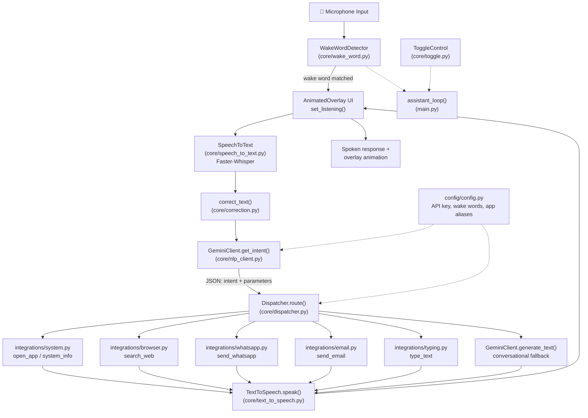

<div align="center">

# 🤖 Jarvis — Mini Voice Assistant

### A bilingual (English + Telugu), wake-word activated desktop voice assistant for Windows, powered by Faster-Whisper STT and Google Gemini for intent understanding.


</div>

---

## 📖 Overview

**Jarvis** is a lightweight, always-listening desktop assistant that wakes up on a spoken trigger word (*"Hello"*, *"Jarvis"*, or *"Ultron"*), transcribes your command locally using **Faster-Whisper**, sends it to the **Gemini API** for intent extraction, and dispatches the result to the right handler — opening apps, searching the web, sending WhatsApp messages, typing text, reporting system stats, or just having a conversation. A frameless, always-on-top animated overlay (built with Tkinter) gives real-time visual feedback of the assistant's state.

## ✨ Features

| Feature | Description |
|---|---|
|  **Wake Word Detection** | Listens continuously for `hello`, `jarvis`, or `ultron` using fuzzy matching (`difflib`) on Whisper transcriptions |
|  **Offline Speech-to-Text** | Local transcription via `faster-whisper` — no audio leaves your machine for STT |
|  **AI Intent Parsing** | Google Gemini (`gemini-flash-latest`) converts natural language into structured `{intent, parameters}` JSON, with regex-based manual fallback if the API fails |
|  **Offline Text-to-Speech** | `pyttsx3` speaks responses aloud with adjustable rate, volume, voice, and emotion presets (excited / calm / serious) |
|  **Bilingual Support** | Auto-detects English vs. Telugu (Unicode range check) and responds accordingly |
|  **App Launching** | Opens Windows apps/settings via a configurable alias map (`cmd`, `notepad`, `chrome`, `WhatsApp`, `calculator`, etc.) |
|  **WhatsApp & Email Automation** | Sends WhatsApp messages via UI automation (`pyautogui`); email is stubbed for future SMTP integration |
|  **Web Search** | Opens a Google search for the requested query in your default browser |
|  **Auto-Typing** | Types dictated or AI-generated text directly into any application |
|  **System Info** | Reports live CPU, RAM, and battery stats via `psutil` |
|  **Command Auto-Correction** | Regex-based correction layer fixes common mis-transcriptions (e.g. *"water"* → *"whatsapp"*, *"calender"* → *"calendar"*) |
|  **Animated Glow Overlay** | Frameless, draggable, always-on-top Tkinter HUD with pulsing glow rings that react to listening/speaking state and live mic amplitude |
|  **Colorized Logging** | Color-coded console logs (info/warning/error) via `colorama` |

---

## 🏗️ Architecture



**Flow in short:** `main.py` starts a background thread (`assistant_loop`) and the Tkinter overlay on the main thread. The loop listens for a wake word → records a command → transcribes it → auto-corrects it → sends it to Gemini for intent classification → the `Dispatcher` executes the matching integration → the result is spoken back and shown on the overlay. The loop repeats until a stop command/intent is detected.

---

## 📁 Project Structure

```
mini_voice_assistant/
└── jarvis_assistant/
    ├── main.py                     # Entry point — starts overlay UI + assistant loop thread
    ├── requirements.txt
    │
    ├── config/
    │   └── config.py               # API key, wake words, ASSISTANT_ACTIVE toggle, app aliases
    │
    ├── core/
    │   ├── wake_word.py            # Wake-word detection (Whisper + fuzzy match)
    │   ├── speech_to_text.py       # Command transcription (Faster-Whisper)
    │   ├── model_manager.py        # Shared Whisper model instance
    │   ├── correction.py           # Regex-based mis-transcription fixes
    │   ├── nlp_client.py           # GeminiClient — intent extraction + text generation
    │   ├── dispatcher.py           # Routes parsed intents to integrations
    │   ├── text_to_speech.py       # pyttsx3 wrapper — speak, change voice, set emotion
    │   ├── toggle.py                # ON/OFF control for the assistant loop
    │   └── logger.py                # Colorized logging setup
    │
    ├── integrations/
    │   ├── system.py               # Open apps / windows settings
    │   ├── browser.py              # Google web search
    │   ├── whatsapp.py             # Automated WhatsApp Desktop messaging
    │   ├── email.py                # Email sending (stubbed)
    │   └── typing.py               # Auto-type text into active/target app
    │
    └── ui/
        ├── overlay.py              # Basic Tkinter status window (legacy/simple version)
        ├── animated_overlay.py     # Frameless glowing HUD, mic-reactive, draggable
        └── styles.css              # Reference styling (for a possible web-based UI)
```

---

## ⚙️ Prerequisites

- **OS:** Windows 10/11 (integrations use Windows-specific `start`, `shell:AppsFolder`, and app IDs like WhatsApp's package ID)
- **Python:** 3.10+ (developed/tested on 3.12)
- **Microphone** and **speakers**
- **GPU with CUDA** *(optional but recommended)* — `faster-whisper` is configured with `device="cuda"` by default; switch to `"cpu"` in `core/wake_word.py` and `core/speech_to_text.py` if you don't have one
- A **Google Gemini API key** — [Get one here](https://ai.google.dev/)

---

##  Getting Started (from GitHub)

### 1. Clone the repository
```bash
git clone https://github.com/<vardhanrajt6-pixel>/mini_voice_assistant.git
cd mini_voice_assistant/jarvis_assistant
```

### 2. Create a virtual environment
```bash
python -m venv venv
venv\Scripts\activate        # Windows
# source venv/bin/activate   # macOS/Linux
```

### 3. Install dependencies
```bash
pip install -r requirements.txt
```

### 4. Configure your API key
Open `config/config.py` and set your Gemini key:
```python
GEMINI_API_KEY = "your_api_key_here"
```
> ⚠️ **Never commit your real API key.** See the [Security Notes](#-security-notes) section below.

### 5. Run the assistant
```bash
python main.py
```
Say **"Hello"**, **"Jarvis"**, or **"Ultron"** to wake it up, then speak your command. Say **"stop"**, **"exit"**, or **"quit"** anytime to shut it down.

---

##  Configuration Reference (`config/config.py`)

| Setting | Purpose |
|---|---|
| `ASSISTANT_ACTIVE` | Master on/off switch checked at startup |
| `WAKE_WORDS` | List of trigger words for `WakeWordDetector` |
| `GEMINI_API_KEY` | Your Gemini API credential |
| `DEFAULT_LANGUAGE`, `DEFAULT_TTS_RATE`, `DEFAULT_TTS_VOLUME` | TTS defaults |
| `APP_ALIASES` | Maps spoken app names (e.g. `"terminal"`) → real executable/command/AppID |

---

##  Example Voice Commands

| You say | Intent | What happens |
|---|---|---|
| "Jarvis, open chrome" | `open_app` | Launches Google Chrome |
| "Search for best pizza near me" | `search_web` | Opens a Google search in your browser |
| "Send a WhatsApp to Mom saying I'll be late" | `send_whatsapp` | Automates WhatsApp Desktop to send the message |
| "Type 'meeting notes' in notepad" | `type_text` | Opens Notepad and types the text |
| "What's my system status" | `system_info` | Speaks CPU / RAM / battery percentages |
| "Change your voice" | `change_voice` | Cycles to the next available TTS voice |
| "Tell me a joke" | *(conversational)* | Falls through to Gemini's `generate_text` |
| "Jarvis, stop" | `stop_assistant` | Gracefully shuts down the assistant + overlay |

---

##  Tech Stack

| Layer | Technology |
|---|---|
| Speech-to-Text | [Faster-Whisper](https://github.com/SYSTRAN/faster-whisper) |
| Text-to-Speech | [pyttsx3](https://pypi.org/project/pyttsx3/) |
| NLP / Intent Extraction | [Google Gemini API](https://ai.google.dev/) |
| Audio I/O | `sounddevice`, `numpy` |
| Desktop Automation | `pyautogui`, `subprocess`, `os` |
| System Metrics | `psutil` |
| GUI Overlay | `tkinter` |
| Logging | `colorama` + `logging` |

---

## 🔒 Security Notes

- `config/config.py` currently stores the Gemini API key as plain text. **Before pushing to GitHub**, move it to an environment variable or a git-ignored `secrets.py` / `.env` file, e.g.:
  ```python
  import os
  GEMINI_API_KEY = os.getenv("GEMINI_API_KEY", "")
  ```
- The included `.gitignore` already excludes `.env`, `secrets.py`, and model/cache folders — double-check `git status` before your first commit so no key is ever pushed.
- If a key was ever committed, **rotate it immediately** in the Google AI Studio console, since git history retains old commits even after deletion.

---

##  Tracking Changes & Contributing

```bash
# Check what's changed
git status

# Stage and commit
git add .
git commit -m "Describe your change"

# Push to GitHub
git push origin main

# Create a feature branch
git checkout -b feature/your-feature-name
git push -u origin feature/your-feature-name
```

1. Fork the repo
2. Create your feature branch (`git checkout -b feature/xyz`)
3. Commit your changes
4. Push to the branch and open a Pull Request

---

##  Known Limitations

- Windows-only integrations (`system.py`, `whatsapp.py` rely on `shell:AppsFolder` and Windows app IDs)
- WhatsApp/email automation is UI-simulation based (`pyautogui`) — fragile if window focus/layout changes
- `email.py` is currently a stub and does not actually send mail
- Requires a CUDA GPU by default for real-time Whisper performance (configurable to CPU)
- API key is stored in plain text in `config.py` by default (see [Security Notes](#-security-notes))

## 🗺️ Roadmap

- [ ] Move secrets to `.env` / environment variables
- [ ] Implement real SMTP email sending
- [ ] Add a settings UI instead of editing `config.py` directly
- [ ] Cross-platform support (macOS/Linux app launching)
- [ ] Add unit tests for `dispatcher.py` intent routing

---

##  License

This project is licensed under the **MIT License** — feel free to use, modify, and distribute with attribution.

<div align="center">

Made with 🎙️ and 🧠 — *Jarvis Mini Voice Assistant*

</div>